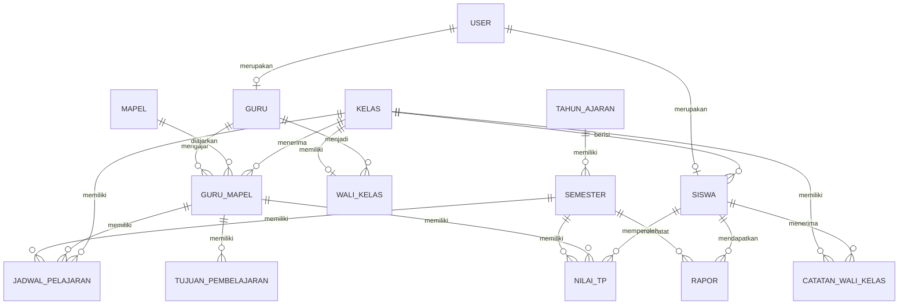
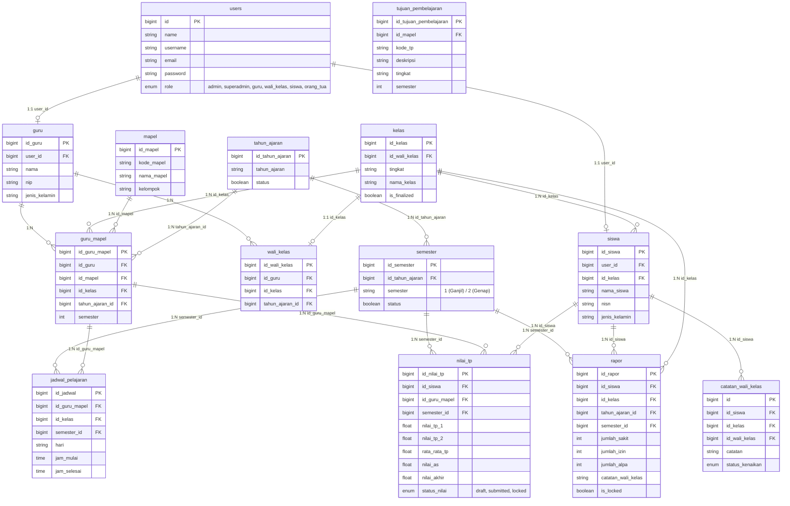

# ERD dan CDM SIAKAD SMK Sunan Giri

Anda dapat menyalin kode Mermaid di bawah ini dan mem-paste-nya ke dalam aplikasi **Draw.io** (diagrams.net).
**Cara Import di Draw.io:**
1. Buka Draw.io (https://app.diagrams.net/).
2. Pilih menu **Arrange** -> **Insert** -> **Advanced** -> **Mermaid...** (atau **Tools** -> **Mermaid**).
3. Paste kode di bawah ini lalu klik **Insert**.

## 1. Conceptual Data Model (CDM)
Model konseptual berfokus pada entitas utama dan relasinya secara garis besar, tanpa menyertakan tipe data atau technical details.

## 2. Entity Relationship Diagram (ERD) / Physical Data Model
Model fisik/relasional ini menyertakan struktur tabel lengkap, foreign keys (termasuk relasi `semester_id` yang baru direvisi), dan tipe data utama.

